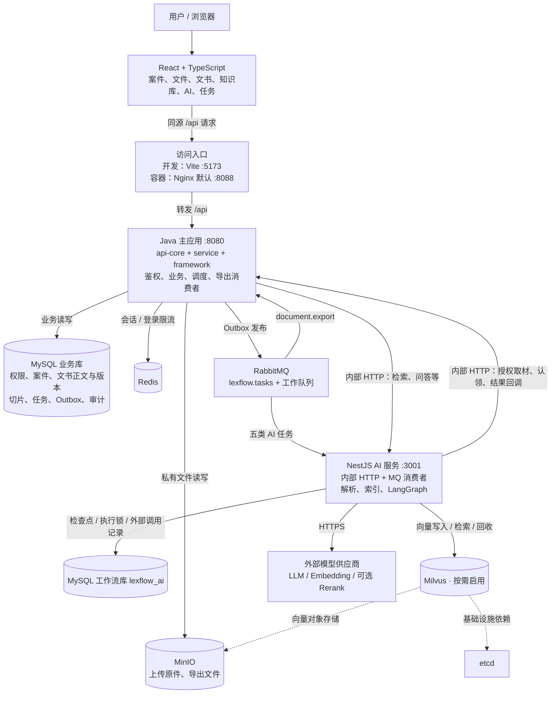
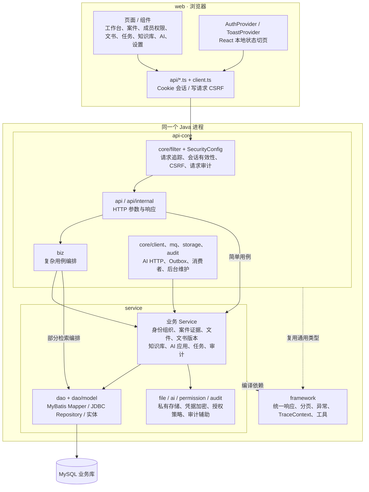
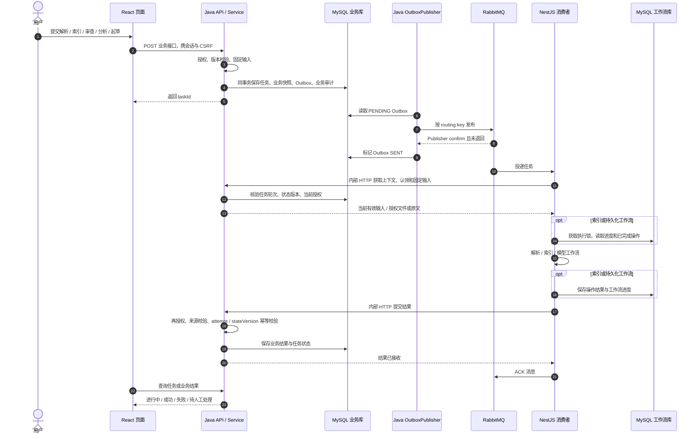
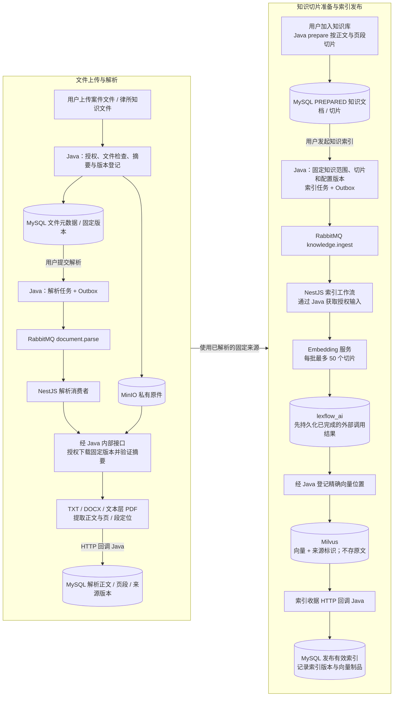
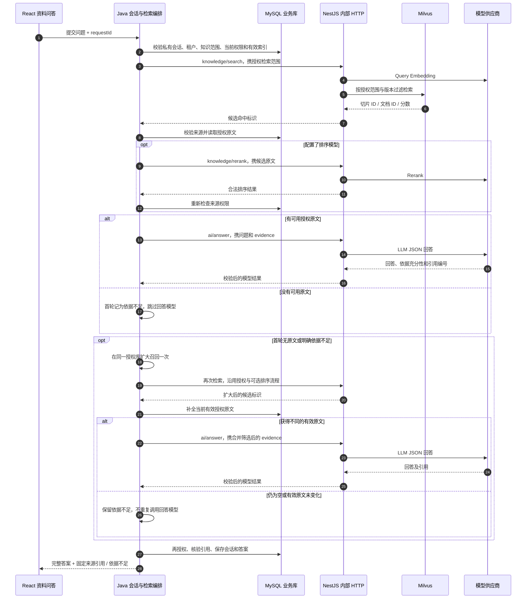
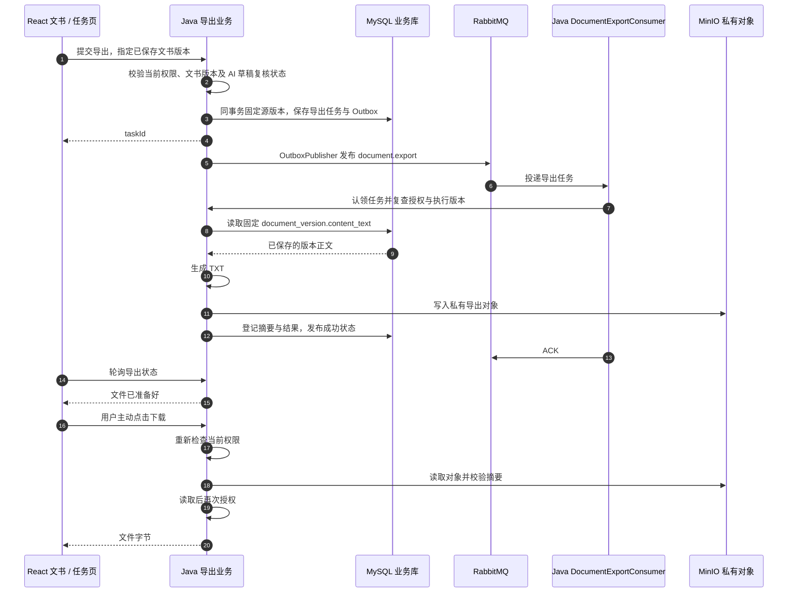
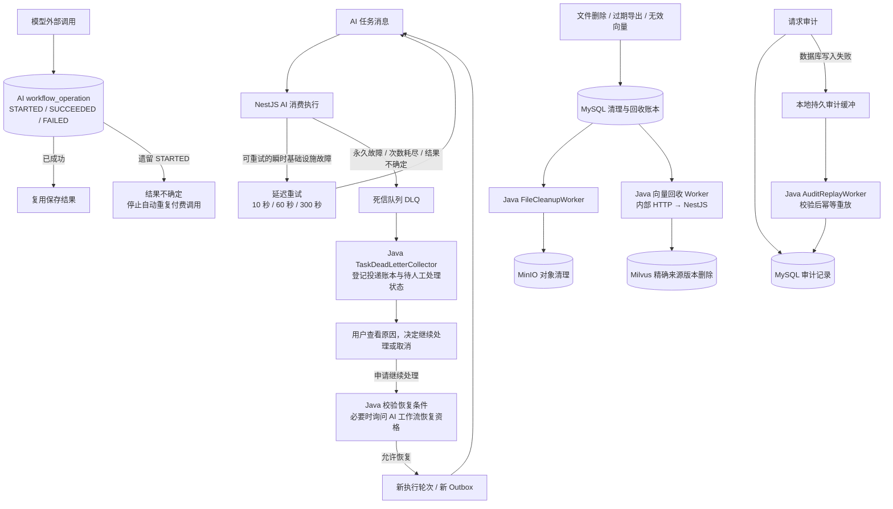

# LexFlow 项目架构与核心链路图

核对日期：2026-10-29。依据当前工作区源码和部署配置整理；描述代码中已经接入的链路，不代表当前机器已运行这些服务或外部模型已通过质量验证。

阅读顺序：先看运行总图和代码分层，再按业务查看异步任务、文件与索引、资料问答、文书导出，最后看异常恢复。

可直接查看或放大：[总览 PNG](../output/architecture-2026-10-29/01-overview.png)、[总览 SVG](../output/architecture-2026-10-29/01-overview.svg)、[代码分层](../output/architecture-2026-10-29/02-code-layers.svg)、[异步任务](../output/architecture-2026-10-29/03-async-tasks.svg)、[文件与索引](../output/architecture-2026-10-29/04-files-and-index.svg)、[RAG 问答](../output/architecture-2026-10-29/05-rag-question.svg)、[文书导出](../output/architecture-2026-10-29/06-document-export.svg)、[恢复与审计](../output/architecture-2026-10-29/07-recovery-and-audit.svg)。

## 1. 整体运行架构

- `api-core`、`service`、`framework` 打包在同一个 Java 应用中。`ai-service` 是另一个独立进程。
- MVP Compose 的两个 MySQL 逻辑库部署在同一个 MySQL 实例，使用不同账号。Java 持有业务数据；AI 通过 Java 内部接口访问授权材料，仅直连自己的工作流库、Milvus 和模型服务。
- 浏览器统一通过 Java API；Nginx 拦截 `/internal/`。开发入口使用 Vite 代理，容器入口使用 Nginx。
- 实线表示应用调用或数据访问；虚线表示 Milvus 的基础设施依赖。Milvus 和 etcd 属于可选 `vector` profile。

证据：[根 Maven 配置](../pom.xml)、[前端代理](../web/vite.config.ts)、[Nginx 配置](../deploy/nginx.conf)、[MVP Compose](../docker-compose.mvp.yml)、[AI 启动入口](../ai-service/src/main.ts)。

## 2. 代码分层与业务职责

编译依赖为 `api-core → service → framework`。Biz 用于复杂接口编排，普通 CRUD 可以直接由 Controller 调用 Service。服务层落实租户隔离、案件权限、事务和版本校验；前端控件显隐不代替后端授权。

前端当前通过 React 状态切换页面。登录身份保存在服务端 Redis Session；启动读取 `/api/v1/auth/me`，写请求附带 CSRF token。请求追踪与审计贯穿接口路径。

证据：[Java 分层约定](java-code-structure.md)、[前端入口](../web/src/App.tsx)、[API 客户端](../web/src/api/client.ts)、[安全配置](../api-core/src/main/java/com/lexflow/website/core/config/SecurityConfig.java)、[案件接口](../api-core/src/main/java/com/lexflow/website/api/CaseController.java)。

## 3. 异步任务通用链路

当前实际消费分工：

| 队列 | 消费方 | 结果落点 |
|---|---|---|
| `lexflow.q.document.parse` | NestJS | Java 保存解析正文和页/段信息 |
| `lexflow.q.knowledge.ingest` | NestJS | Milvus 向量；Java 接收索引收据并发布有效索引 |
| `lexflow.q.contract.review` | NestJS | Java 保存合同报告或待人工状态 |
| `lexflow.q.case.analysis` | NestJS | Java 保存案件分析或待人工状态 |
| `lexflow.q.document.generate` | NestJS | Java 保存独立待复核文书版本 |
| `lexflow.q.document.export` | Java | 私有 MinIO TXT 文件和导出任务结果 |

AI 结果当前通过内部 HTTP 回调 Java。配置中存在的 `lexflow.results` 结果拓扑没有承担当前主要回传链路。

Outbox 保证至少一次投递，消费者必须处理重复消息。合同审查、文书生成和导出等结果面板按需轮询；任务列表通过加载、手动刷新和操作后查询更新。问答等待完整 HTTP 响应，当前没有 SSE / WebSocket 推送。

证据：[任务服务](../service/src/main/java/com/lexflow/service/TaskService.java)、[Outbox 发布器](../api-core/src/main/java/com/lexflow/website/core/mq/OutboxPublisher.java)、[RabbitMQ 配置](../api-core/src/main/java/com/lexflow/website/core/config/RabbitMqConfig.java)、[AI 回调服务](../ai-service/src/infrastructure/java/task-callback.service.ts)、[AI 消费启动](../ai-service/src/main.ts)。

### AI 工作流内部步骤与人工环节

| 用例 | 当前执行步骤 | 人工处理 |
|---|---|---|
| 合同审查 | `parseDocument → extractClauses → retrieveKnowledge → analyzeRisk → [deepReview] → generateReport` | 高风险、依据冲突、缺资料或依据不足等触发 `humanReview` 中断；Java 保存决定后重新投递恢复 |
| 案件分析 | `extractMaterialFacts → analyzeDisputes → [reviewHighRisk] → buildAnalysisReport` | 存在高风险、待核实事实或依据不足等触发 `humanReview` 中断 |
| 文书生成 | `generateDraft → validateDraft` | Java 收到结果后保存 `AI_DRAFT`；用户另行复核，通过后才切换当前版本 |
| 知识索引 | 固定切片 → 分批 Embedding → 持久化结果 → 登记向量位置 → Milvus upsert → 索引收据 | 使用工作流存储的锁和操作日志，本身没有构建 LangGraph StateGraph |

合同的 `deepReview` 由高风险或依据冲突触发；案件的 `reviewHighRisk` 由高风险触发。方括号表示条件分支。合同与案件工作流可在无需人工时直接结束。文书生成图本身没有人工中断节点，生成任务成功也不等于文书已复核或已发布。

证据：[合同图](../ai-service/src/workflows/contract-review/contract-review.graph.ts)、[案件分析图](../ai-service/src/workflows/case-analysis/case-analysis.graph.ts)、[文书生成图](../ai-service/src/workflows/document-generation/document-generation.graph.ts)、[文书版本复核](../service/src/main/java/com/lexflow/service/DocumentService.java)。

## 4. 文件上传、解析与知识入库

上传、解析、知识切片准备和索引发布是不同阶段。解析回调保存正文与页段，加入知识库时由 Java 准备切片；索引消费者使用已准备的切片。普通文档解析不调用模型，当前没有自动 OCR。案件知识和律所公共知识使用各自的授权范围。

Milvus Collection 按模型身份与维度隔离。检索还需限定租户、知识库、案件或公共范围、有效索引版本及授权文档。原文始终由 Java 按当前权限提供。

证据：[文件前端请求](../web/src/api/files.ts)、[解析消费者](../ai-service/src/documents/document-parse.consumer.ts)、[解析器](../ai-service/src/documents/parsers/document.parser.ts)、[知识切片准备](../service/src/main/java/com/lexflow/service/KnowledgeService.java)、[索引工作流](../ai-service/src/knowledge/knowledge-index-workflow.service.ts)、[索引器](../ai-service/src/knowledge/knowledge-indexer.ts)、[Milvus 存储](../ai-service/src/knowledge/milvus-knowledge.store.ts)。

## 5. 资料检索与 RAG 问答

整个问答编排在 Java 的 `AiConversationBiz` 和 `KnowledgeSearchBiz`；AI 服务负责检索、可选排序和回答的执行。有效资料不足时最多扩大一次，回答模型最多调用两次；异常或引用无效不会自动重发付费调用。用户点击引用下载时仍通过 Java 再授权。

证据：[会话编排](../api-core/src/main/java/com/lexflow/website/biz/AiConversationBiz.java)、[检索编排](../api-core/src/main/java/com/lexflow/website/biz/KnowledgeSearchBiz.java)、[检索接口](../ai-service/src/knowledge/knowledge-search.controller.ts)、[问答接口](../ai-service/src/ai/legal-question.controller.ts)、[问答页面](../web/src/pages/Cases/CaseQuestionPanel.tsx)。

## 6. 文书异步导出

导出由同一个 Java 应用内的消费者执行。未复核的 AI 草稿不能导出；任务固定提交时的已保存版本，之后编辑不改变该任务结果。成功只表示文件已生成。取消会撤销结果发布资格，迟到对象进入清理登记。

证据：[导出编排](../api-core/src/main/java/com/lexflow/website/biz/DocumentExportBiz.java)、[Java 导出消费者](../api-core/src/main/java/com/lexflow/website/core/mq/DocumentExportConsumer.java)、[导出业务服务](../service/src/main/java/com/lexflow/service/DocumentExportService.java)、[导出源正文查询](../service/src/main/java/com/lexflow/dao/DocumentExportRepository.java)、[导出面板](../web/src/pages/Cases/DocumentExportPanel.tsx)。

## 7. 异常恢复、清理与审计

“待人工复核报告”和“外部调用结果不确定”可能都使用 `WAITING_HUMAN`，但含义及可执行操作不同。结果不确定时不能通过确认报告绕过检查；继续处理也不承诺会重新调用模型。

上图的死信收集与待人工处理路径针对五类 AI 任务。文书导出使用 Java 的租约检查和延迟 Outbox 重投，常见存储故障或租约过期最多延迟重试三次，耗尽后进入 `FAILED`。导出消费者未能处理的异常会进入独立导出 DLQ，由租约恢复或排队任务人工重投兜底，不由上述 AI 死信收集器统一处理。

AI 工作流库保存线程锁、检查点、检查点写入及独立外部调用操作记录。检查点用于恢复进度，操作日志用于复用已完成结果；这两个机制共同约束重复执行。内部 HTTP 校验服务凭据，外部模型调用限制为白名单 HTTPS 域名，SDK 不自动重试。

仓库另有 `ops/backup` 离线加密备份恢复工具，覆盖业务库、AI 工作流库及被引用对象，并支持独立审计缓冲备份。数据库恢复时将向量索引失效，后续需主动重建；该工具不应画成常驻在线服务，也不表示完整备份恢复验收已经完成。

证据：[投递与重试](../ai-service/src/infrastructure/messaging/task-delivery.service.ts)、[工作流存储](../ai-service/src/infrastructure/persistence/mysql-checkpointer.ts)、[工作流表](../ai-service/sql/001_workflow_checkpoints.sql)、[死信收集](../api-core/src/main/java/com/lexflow/website/core/mq/TaskDeadLetterCollector.java)、[请求审计写入](../service/src/main/java/com/lexflow/service/audit/RequestAuditWriter.java)、[备份工具](../ops/backup/lexflow-backup.cjs)。
